<!-- Obsidian / Design 27. Upload this file together with the assets folder. -->

<picture>
  <source media="(max-width: 600px)" srcset="./assets/hero-mobile.svg">
  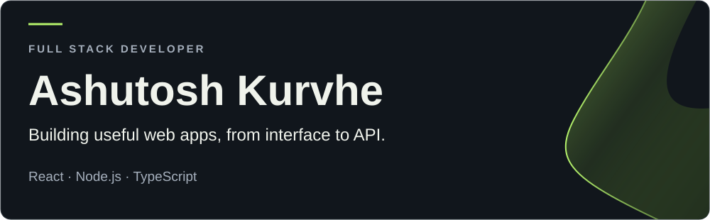
</picture>

  <a href="https://www.linkedin.com/in/ashutoshkurvhe/">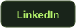</a>
  <a href="mailto:kurvheashutosh@gmail.com">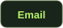</a>
  <a href="https://github.com/ashutoshkurvhe?tab=repositories">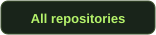</a>

I'm a **full-stack developer based in India**, working with the MERN stack and TypeScript. I enjoy connecting thoughtful React interfaces with Node.js APIs and clear data models.

- **Building:** RouteWise and Personal Productivity OS.
- **Practising:** system design and data structures & algorithms in JavaScript.
- **Ask me about:** React, Node.js, Express, MongoDB and full-stack development.

## Selected work

<picture>
  <source media="(max-width: 600px)" srcset="./assets/routewise-mobile.svg">
  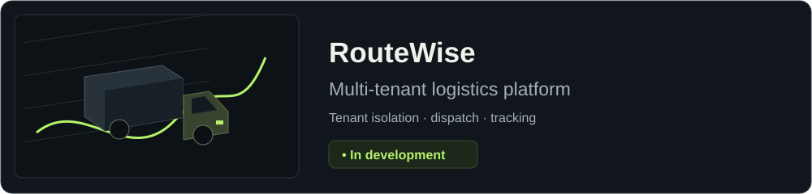
</picture>

RouteWise is in development. Its repository is currently private.

<a href="https://github.com/ashutoshkurvhe/Personal-Productivity-OS">
  <picture>
    <source media="(max-width: 600px)" srcset="./assets/productivity-mobile.svg">
    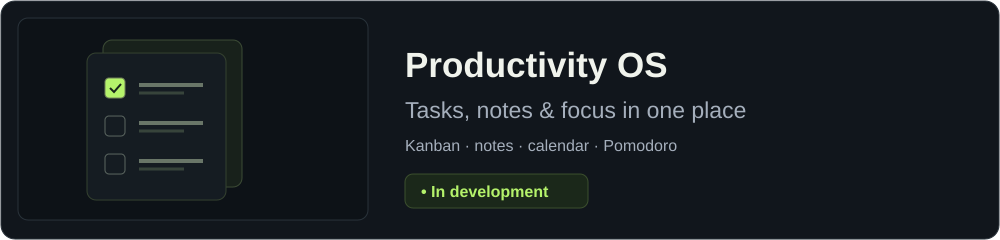
  </picture>
</a>

<a href="https://github.com/ashutoshkurvhe/Personal-Productivity-OS">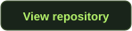</a>

<strong>More projects from my repositories</strong>

- [E-Commerce-MERN](https://github.com/ashutoshkurvhe/E-Commerce-MERN)
- [expense-tracker-app](https://github.com/ashutoshkurvhe/expense-tracker-app)
- [Fitness-Park](https://github.com/ashutoshkurvhe/Fitness-Park)
- [Photographer-Portfolio](https://github.com/ashutoshkurvhe/Photographer-Portfolio)
- [Plant-Shop](https://github.com/ashutoshkurvhe/Plant-Shop)

## Tech stack

**Languages**

  
  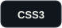
  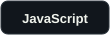
  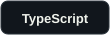

**Frontend**

  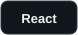
  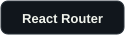
  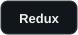
  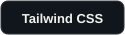
  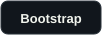
  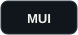
  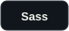
  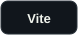

**Backend & database**

  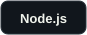
  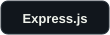
  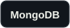
  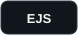

**Developer tools**

  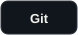
  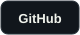
  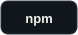
  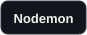

## GitHub activity

<a href="https://github.com/ashutoshkurvhe?tab=overview">
  <picture>
    <source media="(max-width: 600px)" srcset="./assets/metrics/overview-mobile.svg">
    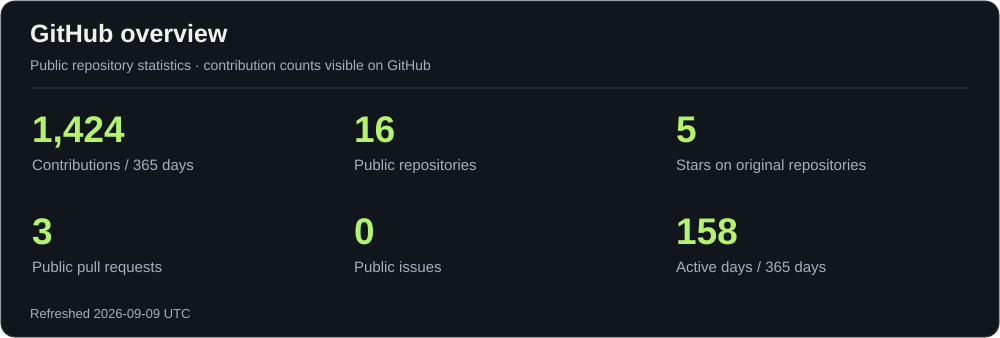
  </picture>
</a>

<picture>
    <source media="(max-width: 600px)" srcset="./assets/metrics/streak-mobile.svg">
    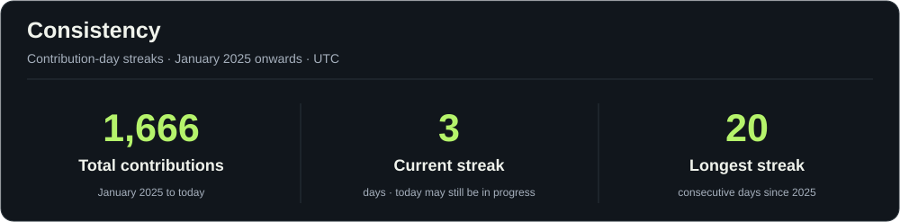
  </picture>

<picture>
    <source media="(max-width: 600px)" srcset="./assets/metrics/languages-mobile.svg">
    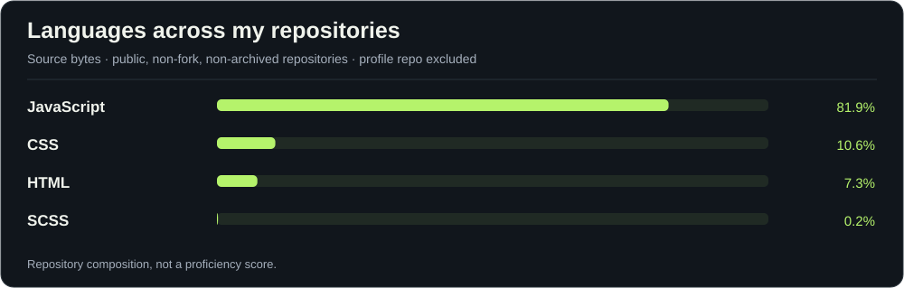
  </picture>

**Let's connect**

  
  

  

